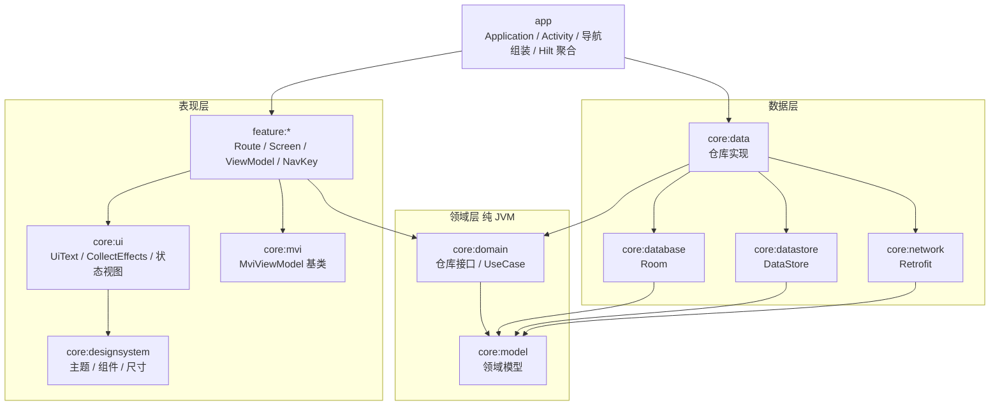
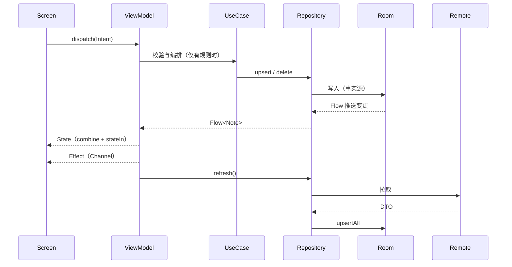

# 架构说明

本文说明脚手架的分层、依赖方向、数据流、依赖注入、导航与平台适配。示例业务是一个“笔记”应用：列表（Home）、详情编辑（Detail）、设置（Settings）。示例只用来演示各层如何协作，删掉后不影响脚手架本身。

## 1. 设计目标

- 单 Activity + 纯 Compose 页面，不使用 Fragment。
- 单向数据流：`Intent -> ViewModel -> State -> UI`，一次性事件走 `Effect`。
- 分层清晰：UI -> Domain（纯 JVM）<- Data；业务规则不依赖 Android。
- 离线优先：Room 是事实源，网络只负责刷新。
- 边界可演进：同一套包结构既能放在单模块，也能按目录拆成多模块，迁移时包名不变。
- 构建可复用：版本目录统一管理版本，`build-logic` 约定插件统一 SDK、Kotlin、Compose、Hilt、Room、测试依赖。

## 2. 分层与依赖方向

规则：

1. 依赖只能向下、向内：UI 依赖 Domain，Data 依赖 Domain，Domain 不依赖任何人。
2. 仓库接口（`NotesRepository`、`SettingsRepository`）定义在 Domain，实现在 Data，由 Hilt `@Binds` 绑定。
3. feature 之间零依赖。跨 feature 的跳转由 `app` 组装并以回调注入。
4. `app` 是唯一知道“所有模块”的地方：导航图、Hilt 聚合、主题与启动流程。
5. 只有接口跨模块暴露。例如网络层对外只暴露 `NotesRemoteDataSource`，Retrofit、OkHttp、Moshi 的类型不泄漏到其它模块，也不会进入 `app` 的编译类路径。

## 3. 模块职责（多模块形态）

| 模块 | 类型 | 职责 |
|:---|:---|:---|
| `:app` | Android 应用 | `@HiltAndroidApp`、`MainActivity`、`AppNavHost`、启动页、主题切换、混淆与签名配置 |
| `:core:mvi` | Android 库 | `UiState`/`UiIntent`/`UiEffect`、`MviViewModel`、`SelfOwnedMviViewModel` |
| `:core:common` | JVM 库 | 调度器限定符与注入、`ApplicationScope`、`Clock`、`suspendRunCatching` |
| `:core:model` | JVM 库 | `Note`、`UserSettings`、`ThemeMode` 等领域模型，无任何框架依赖 |
| `:core:domain` | JVM 库 | `NotesRepository`、`SettingsRepository` 接口，`SaveNoteUseCase`（含校验规则） |
| `:core:database` | Android 库 | Room 数据库、实体、DAO，导出 schema |
| `:core:datastore` | Android 库 | Preferences DataStore 数据源 |
| `:core:network` | Android 库 | Retrofit/OkHttp/Moshi，`safeApiCall` 统一错误映射；未配置 `apiBaseUrl` 时为空实现 |
| `:core:data` | Android 库 | 仓库实现（离线优先），Hilt 绑定 |
| `:core:analytics` | Android 库 | `AnalyticsTracker` 接口、事件定义、Timber 实现（SDK 封装范例） |
| `:core:designsystem` | Android 库 | Material 3 主题（含动态取色）、`AppDimens`、通用组件 |
| `:core:ui` | Android 库 | `UiText`、`CollectEffects`、`rememberSyncedTextFieldState`、空/错误/加载视图 |
| `:core:testing` | JVM 库 | `MainDispatcherRule`、Fake 仓库、测试数据、`keepCollecting` |
| `:feature:home` | Android 库 | 笔记列表（下拉刷新、删除、大屏选中态） |
| `:feature:detail` | Android 库 | 笔记新建/编辑/删除（自持有状态 + 校验） |
| `:feature:settings` | Android 库 | 主题模式与动态取色（派生状态 + 只读 Effect） |

单模块形态下，上表每一行对应 `app/src/main/kotlin/com/example/globalarch/` 下的同名子包：`core/<name>`、`feature/<name>`，包名与多模块完全一致。

## 4. 数据流

要点：

- 读取永远来自数据库，网络只是把结果写回数据库，界面通过 Flow 自动更新；离线时同样可用。
- 只有存在业务规则的操作才引入 UseCase（本例仅 `SaveNoteUseCase`：标题非空、长度限制、更新时间）。纯转发的 UseCase 一律不写，ViewModel 直接用仓库。
- 异常在边界处收敛：`safeApiCall` 把网络层异常映射为 `NetworkException`，仓库返回 `Result`，ViewModel 把失败映射成 `UiText` 提示。

## 5. 依赖注入（Hilt）

- `@HiltAndroidApp` 在 `GlobalArchApplication`，`@AndroidEntryPoint` 在 `MainActivity`。
- ViewModel 使用 `@HiltViewModel`；带参数的用 `@HiltViewModel(assistedFactory = ...)` + `@AssistedInject`，Compose 里 `hiltViewModel<VM, VM.Factory>(creationCallback = ...)`。
- 各模块自带 `@Module @InstallIn(SingletonComponent::class)`，绑定实现用 `@Binds`，三方库对象用 `@Provides`。
- 编译期使用 KSP（不使用 kapt）。
- Hilt 聚合要求 `app` 的编译类路径包含所有带 `@Module` 的模块，所以 `app/build.gradle.kts` 显式依赖全部 `core` 与 `feature` 模块。新增带 Hilt 模块的库模块时，别忘了在 `app` 里加依赖，否则运行期才会发现缺绑定。
- 调度器通过限定符注入：`@Dispatcher(AppDispatchers.IO)`，测试时可替换；应用级协程作用域用 `@ApplicationScope`。

## 6. 导航（Navigation 3）

- 页面标识是可序列化的 `NavKey`：`HomeNavKey`、`NoteDetailNavKey(noteId)`、`SettingsNavKey`。
- `AppNavHost` 持有返回栈（`rememberNavBackStack`），用 `NavDisplay` 渲染，装饰器 `rememberSaveableStateHolderNavEntryDecorator()` 与 `rememberViewModelStoreNavEntryDecorator()` 保证每个页面有独立的状态与 ViewModel 作用域。
- 每个 feature 对外只暴露一个入口构建函数，例如 `EntryProviderScope<NavKey>.homeEntry(onOpenNote, onAddNote, onOpenSettings, ...)`。feature 不认识其它 feature，跳转通过回调交给 `app`。
- 大屏自适应：`Home` 与 `Detail` 通过 `ListDetailSceneStrategy` 的元数据声明为列表栏和详情栏。宽屏下同时显示，窄屏下按栈显示单页；宽屏下点击另一条笔记会替换右栏而不是不断压栈。
- 返回：开启预测性返回（`enableOnBackInvokedCallback`），由 `NavDisplay` 的 `onBack` 统一处理。

## 7. 平台适配清单

| 能力 | 做法 |
|:---|:---|
| 边到边 | `enableEdgeToEdge()` + `SystemBarStyle.auto`；内容用 `Scaffold` 的 `padding`，输入页追加 `imePadding()` |
| 预测性返回 | Manifest `android:enableOnBackInvokedCallback="true"` |
| 启动页 | `core-splashscreen`，主题 `Theme.GlobalArch`；`MainActivity` 通过 `setKeepOnScreenCondition` 等待首个主题状态，避免闪白 |
| 动态取色 | Android 12 及以上使用 `dynamicColorScheme`，低版本回退自定义配色，设置页开关仅在支持的系统上显示 |
| 深色模式 | 设置页三态：跟随系统、浅色、深色，保存于 DataStore |
| 多语言 | 资源默认英文，附带 `values-zh-rCN`；`locales_config.xml` 声明支持语言，启用系统“应用语言”设置 |
| 16 KB 页大小 | 无自带 native 库；依赖带入的 `libandroidx.graphics.path.so`、`libdatastore_shared_counter.so` 在四种 ABI 下 LOAD 段均按 16 KB 对齐，APK 通过 `zipalign -c -P 16 -v 4`；升级依赖后需重新校验 |
| 备份与迁移 | `backup_rules.xml`、`data_extraction_rules.xml` 明确包含数据库与 DataStore |
| 方向与大屏 | 不锁定方向，不设置 `resizeableActivity=false` |
| 无障碍 | 图标按钮均带 `contentDescription`，点击目标不小于 48dp（`AppDimens.MinTouchTarget`） |

## 8. 构建系统

- 版本目录 `gradle/libs.versions.toml` 是唯一版本来源，包括 `compileSdk`、`targetSdk`、`minSdk`。
- `build-logic` 是被 `includeBuild` 的构建，提供约定插件 `scaffold.*`，业务模块只写 `alias(libs.plugins.scaffold.xxx)`。
- AGP 9 内置 Kotlin 支持：不再应用 `org.jetbrains.kotlin.android`，使用新版 DSL（`ApplicationExtension`/`LibraryExtension`/`CommonExtension`）。
- 开启配置缓存、构建缓存、并行；类型安全的项目访问器（`projects.core.mvi`）。
- 发布构建开启 R8 与资源压缩；签名读取根目录 `keystore.properties`，文件不存在时 release 不签名，仓库不保存密钥。
- 可选 Gradle 属性：`-PapiBaseUrl=https://...`（为空时网络层为空实现）、`-PwarningsAsErrors=true`、`-PenableComposeCompilerReports=true`。
- 代码风格：Spotless + ktlint（`android_studio` 风格）。规则写在根 `build.gradle.kts` 的 `ktlintRules`，实测 Spotless 的 ktlint 步骤不读取 `.editorconfig` 里的 ktlint 规则；`.editorconfig` 只保存编辑器通用设置（缩进、行宽、尾逗号），改风格时两处保持一致；Spotless 目标只含各模块 `src` 目录与构建脚本，不遍历 `build/`，避免并行构建时读到被改写的目录而失败。

## 9. 日志与统计

- 日志统一用 Timber；仅在 `BuildConfig.DEBUG` 下种植 `DebugTree`，release 不输出。禁止在日志里打印个人信息、令牌、完整请求体。
- 统计通过 `AnalyticsTracker` 接口使用，默认实现只写 Timber。接入真实 SDK 时只改 `core:analytics` 的实现类与 Hilt 绑定，业务代码不变；事件名与参数集中在 `AnalyticsEvents`，便于审计。

## 10. 新增一个功能模块（多模块形态）

1. 复制 `feature/settings` 作为起点，改 `namespace`、包名与资源前缀。
2. 在 `settings.gradle.kts` 增加 `include(":feature:<name>")`。
3. 在 `app/build.gradle.kts` 增加 `implementation(projects.feature.<name>)`。
4. 在 `AppNavHost` 注册入口并注入跳转回调。
5. 新增 Hilt 模块时确认 `app` 已依赖该库模块。
6. 按 `docs/mvi-guide.md` 第 7 节补齐 Contract、ViewModel、Route、Screen 与测试。
