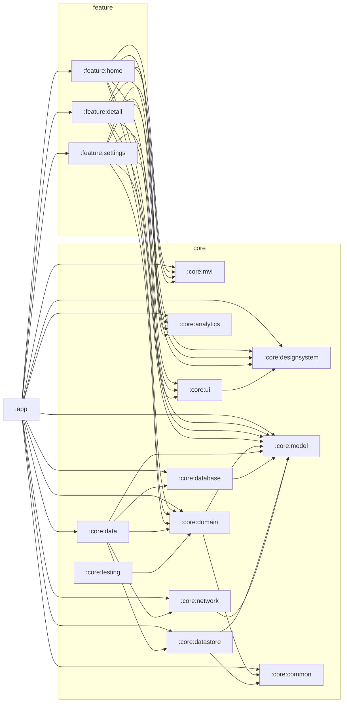

# 模块化与演进

脚手架提供两种工程形态，包名、类名、MVI 写法完全一致：

| | `single-module/` | `multi-module/` |
|:---|:---|:---|
| Gradle 模块 | `:app` + `build-logic` | `:app` + `:core:*` + `:feature:*` + `build-logic` |
| 代码位置 | `app/src/main/kotlin/com/example/globalarch/{core,feature}/<name>/` | 各模块自己的 `src/main/kotlin/com/example/globalarch/{core,feature}/<name>/` |
| 边界约束 | 靠 `PackageBoundaryTest` 扫描 import 强制，`internal` 不隔离 | 靠 Gradle 依赖，违反依赖方向会编译失败 |
| 增量编译 | 改任何文件都重编整个 `app` | 只重编受影响模块及其下游 |
| 适用 | 原型、个人项目、功能少于 10 个页面 | 多人协作、功能持续增长、需要强边界 |
| 资源 | 合并在 `app/src/main/res`，资源名保留模块前缀 | 每个模块自己的 `res` |
| 约定插件 | `application`、`application.compose`、`hilt`、`room` | 另含 `library`、`library.compose`、`feature`、`jvm.library` |

选择建议：先用单模块起步，页面或团队规模上来之后，按本文的步骤逐包拆出。因为包名不变，拆分只是“移动目录 + 补依赖”，业务代码几乎不改。

## 1. 多模块依赖图

## 2. 依赖规则

| 从 \ 到 | feature | ui / designsystem | mvi | domain / model | data 系列 | common |
|:---|:---:|:---:|:---:|:---:|:---:|:---:|
| `app` | 允许 | 允许 | 允许 | 允许 | 允许（Hilt 聚合需要） | 允许 |
| `feature:*` | 禁止 | 允许 | 允许 | 允许 | 禁止 | 允许 |
| `core:ui` | 禁止 | 允许 | 禁止 | 禁止 | 禁止 | 禁止 |
| `core:domain` | 禁止 | 禁止 | 禁止 | 允许 | 禁止 | 允许 |
| `core:data` | 禁止 | 禁止 | 禁止 | 允许 | 允许 | 允许 |

补充：

- `feature` 不依赖任何 `data` 系列模块，只通过 `domain` 的仓库接口取数据。
- `core:model`、`core:domain`、`core:common` 是纯 JVM 模块，不允许出现 `android.*` 引用。
- `core:testing` 只被 `testImplementation` 引用，不进入任何运行时依赖。
- 多模块形态下这些规则由 Gradle 依赖强制。单模块形态由 `app/src/test/kotlin/com/example/globalarch/architecture/PackageBoundaryTest.kt` 在 `testDebugUnitTest` 里强制：它按包名扫描 `src/main/kotlin` 的 import，违反上表依赖方向（例如 `feature` 引用 `core.data`、纯 Kotlin 包引用 `android.*`）就失败。新增 `core.*` 或 `feature.*` 包时，必须在测试的 `ALLOWED_DEPENDENCIES` 里登记。

## 3. 单模块 -> 多模块 迁移步骤

每一步完成后都跑一次 `./gradlew assembleDebug testDebugUnitTest`，保持随时可回退。

1. 把 `build-logic` 与 `gradle/libs.versions.toml` 整个换成 `multi-module` 里的版本。后者是前者的超集：多了 `library`、`library.compose`、`feature`、`jvm.library` 四个约定插件，`hilt`、`room` 插件也多了库模块与纯 JVM 模块的分支，版本目录多了 `hilt-core`、`javax-inject` 与对应插件别名。
2. 从最底层开始拆，顺序：`core:model` -> `core:common` -> `core:domain` -> `core:mvi` -> `core:designsystem` -> `core:ui` -> `core:analytics` -> `core:database` -> `core:datastore` -> `core:network` -> `core:data` -> `core:testing` -> 各 `feature`。
3. 对每个模块：
   - 建目录 `core/<name>/`，写 `build.gradle.kts`（套对应约定插件，设置 `namespace`）；
   - 在 `settings.gradle.kts` 增加 `include(":core:<name>")`；
   - 把 `app/src/main/kotlin/com/example/globalarch/core/<name>/` 整个目录移到 `core/<name>/src/main/kotlin/com/example/globalarch/core/<name>/`；
   - 把相应的 `res`、单元测试、`androidTest` 一并移动；
   - 在依赖它的模块里补 `implementation(projects.core.<name>)`；对外暴露在公共 API 里的类型，用 `api(...)`。
4. 修正三类编译问题：
   - **R 类**：单模块里所有资源都在 `com.example.globalarch.R`；拆出后每个模块有自己的 `R`。资源名已带模块前缀（`designsystem_*`、`ui_*`、`home_*`、`detail_*`、`settings_*`），所以只需要把 `import com.example.globalarch.R` 改成模块自己的 `R`（在同包下无需 import）。
   - **BuildConfig**：`API_BASE_URL` 这类字段搬到 `core:network` 的 `buildFeatures.buildConfig = true` 与 `defaultConfig.buildConfigField`。
   - **可见性**：把需要跨模块使用的 `internal` 类改成 `public`，或补一个公共接口。优先暴露接口，不暴露实现。
5. Hilt：每个新拆出的、带 `@Module` 的模块，都要在 `app/build.gradle.kts` 里加入 `implementation(projects.core.<name>)`，否则 Hilt 聚合看不到该模块，运行期才会报缺失绑定。
6. 全部拆完后删除 `app` 里已经空了的包目录与 `PackageBoundaryTest`（边界改由 Gradle 强制），并在 `docs` 或 README 里更新模块图。

## 4. 多模块 -> 单模块 回退

1. 把所有模块的 `src/main/kotlin`、`res`、测试目录合并到 `app/src/...` 对应位置，包路径保持不变。
2. 把各模块 `AndroidManifest.xml` 中的 `uses-permission`（如 `INTERNET`）合并进 `app` 的 Manifest。
3. 把 `core:network` 的 `buildConfigField` 移到 `app/build.gradle.kts`。
4. 把各模块的 `R` 引用改成 `com.example.globalarch.R`。
5. 依赖合并到 `app/build.gradle.kts`，保留 `ksp(...)`、Room 插件与 `schemaDirectory`。
6. `core:testing` 的内容放进 `app/src/test/kotlin/com/example/globalarch/core/testing/`。
7. 删除 `settings.gradle.kts` 里的 `include` 与已空的模块目录。
8. 把 `single-module` 里的 `PackageBoundaryTest` 拷进 `app/src/test/kotlin/com/example/globalarch/architecture/`，边界改由测试强制。

## 5. 常见问题

| 现象 | 原因与处理 |
|:---|:---|
| 运行时报 `Missing binding` / Dagger 找不到某接口 | 新模块没有被 `app` 依赖，Hilt 聚合不到；在 `app/build.gradle.kts` 加依赖 |
| 编译期报找不到 Retrofit/OkHttp 的类型 | 这些类型本不应泄漏到别的模块；检查是否有模块公开了网络层实现类，改为只暴露 `NotesRemoteDataSource` 这样的接口 |
| 循环依赖 | `feature` 之间互相引用了；把共享的部分下沉到 `core:*`，跨页跳转改为回调由 `app` 注入 |
| 拆模块后资源找不到 | `R` 的 import 仍指向旧包；改成模块自己的 `R`，并确认资源名前缀与模块一致（lint 的 `resourcePrefix` 会提示） |
| 单元测试里找不到 `MainDispatcherRule` | 模块没有 `testImplementation(projects.core.testing)` |
| `ksp` 报 `Unresolved reference` | 把 `ksp(...)` 依赖写在了不对应的配置上；确认模块应用了 `scaffold.android.hilt` / `scaffold.android.room` |

## 6. 两套工程的差异清单

`single-module/` 由 `multi-module/` 机械合并而来，业务代码、包名、测试用例相同，差异只在构建与资源层：

| 项 | `single-module/` | `multi-module/` |
|:---|:---|:---|
| `settings.gradle.kts` | 只 `include(":app")`，不开类型安全项目访问器 | 包含全部模块，开启 `TYPESAFE_PROJECT_ACCESSORS` |
| `app/build.gradle.kts` | 额外套 `scaffold.android.room`、`kotlin.serialization`；Compose、Room、DataStore、Retrofit、OkHttp、Moshi 等库直接依赖；`API_BASE_URL` 写在 `defaultConfig`；`ksp(moshi-kotlin-codegen)` | 只依赖 `projects.*` 与应用壳需要的少量库 |
| `build-logic` | 4 个约定插件：`application`、`application.compose`、`hilt`、`room` | 8 个约定插件 |
| 版本目录 | 去掉 `hilt-core`、`javax-inject` 与库、JVM、feature 的插件别名 | 完整 |
| Manifest | `app` 自己声明 `INTERNET` | 由 `core:network` 的库 Manifest 合并而来 |
| 资源 | 各模块字符串合并为 `values*/strings_<module>.xml`；只有一个 `com.example.globalarch.R`，包名不是 `com.example.globalarch` 的源码需要 `import com.example.globalarch.R` | 每个模块有自己的 `R`，同包无需 import |
| `BuildConfig` | `com.example.globalarch.BuildConfig` | `core:network` 自己的 `BuildConfig` |
| Room schema | `app/schemas/` | `core/database/schemas/` |
| 测试夹具 | `core:testing` 的源码位于 `app/src/test/kotlin/com/example/globalarch/core/testing/` | 独立的 `core:testing` 模块 |
| 测试位置 | 全部在 `app/src/test` 与 `app/src/androidTest`，按包名分目录；额外有 `PackageBoundaryTest` | 随各模块 |

更新其中一套的业务代码后，另一套需要手工同步同名文件；`multi-module/` 是基准版本，改动先在它上面验证。
